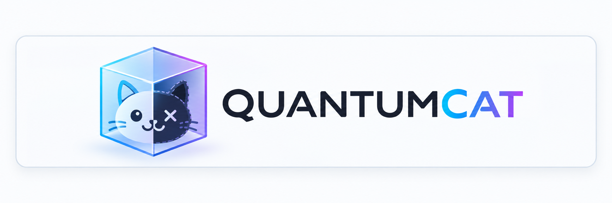

<p align="center">
  <picture>
    <source media="(prefers-color-scheme: dark)" srcset="docs/logo-dark.png">
    <source media="(prefers-color-scheme: light)" srcset="docs/logo-light.png">
    
  </picture>
</p>

**A small, post-quantum point-to-point VPN for connecting devices without a coordination server.**

QuantumCat (`qcat`) combines WireGuard, Tailscale's networking stack, and DERP relay support with post-quantum device authentication and session key establishment.

- No Tailscale account or control plane
- Direct peer-to-peer paths when available, DERP relay when needed
- ML-DSA-87 device authentication
- Fresh ML-KEM-1024 exchange for each connection's WireGuard PSK
- Secure Enclave-backed identities on supported Macs
- TCP, UDP, SSH, Mosh, SOCKS5, and IPv6 TUN modes
- macOS, Linux, and FreeBSD builds

> [!WARNING]
> QuantumCat is an early implementation of [DESIGN.md](DESIGN.md), not a security-audited release. The bootstrap protocol should receive independent cryptographic review before it protects sensitive production traffic.

## What does it look like?

Pair two devices once, then use normal tools through the encrypted tunnel.

### SSH

On your laptop:

```sh
qcat identity init --name laptop > laptop.qpeer
```

On the server:

```sh
qcat identity init --name outpost
qcat peer add laptop laptop.qpeer
qcat serve --tcp 22=127.0.0.1:22 --export outpost.qpeer
```

Back on the laptop:

```sh
qcat peer add outpost outpost.qpeer
qcat connect outpost 22
```

Or make it transparent to OpenSSH:

```sshconfig
Host outpost
    HostName outpost
    User alice
    ProxyCommand /Users/alice/.local/bin/qcat connect outpost 22
```

Then:

```sh
ssh outpost
```

No DNS record named `outpost` is required. SSH still performs its normal host-key and user authentication inside the QuantumCat tunnel.

### Mosh

Publish SSH plus the normal Mosh UDP range on the server:

```sh
qcat serve \
  --tcp 22=127.0.0.1:22 \
  --udp 60000:61000=127.0.0.1:60000 \
  --export outpost.qpeer
```

Then connect from the client:

```sh
qcat mosh outpost
```

`qcat mosh` bootstraps through SSH, creates the UDP forwarding path, and launches `mosh-client`.

### SOCKS5 proxy

Allow a destination on the server:

```sh
qcat serve --allow-target example.com:443 --export outpost.qpeer
```

Run a local SOCKS5 proxy on the client:

```sh
qcat socks --listen 127.0.0.1:1080 outpost
curl --socks5-hostname 127.0.0.1:1080 https://example.com/
```

DNS resolution happens on the remote side.

### UDP forwarding

Publish a UDP service on the server:

```sh
qcat serve --udp 60001=127.0.0.1:60001 --export outpost.qpeer
```

Forward a client-side loopback port to it:

```sh
qcat forward --udp outpost 60001:60001
```

No public UDP listener is created on the server.

## How it works

QuantumCat deliberately separates **identity**, **reachability**, and **transport**.

1. Each device has a long-lived ML-DSA identity.
2. Devices exchange public `.qpeer` descriptors through an authenticated out-of-band channel.
3. A fresh ML-KEM exchange authenticates the peer and derives a new WireGuard PSK.
4. Tailscale's `magicsock` machinery discovers direct paths and falls back to DERP when necessary.
5. Application traffic runs inside WireGuard.

The DERP relay is not trusted for authentication or session confidentiality.

Persistent identity compromise does not by itself reveal old session PSKs.

For the full protocol and threat-model details, see:

- [DESIGN.md](DESIGN.md) — architecture and rationale
- [PROTOCOL.md](PROTOCOL.md) — wire protocol and bootstrap details
- [third_party/tailcat/QUANTUMCAT.md](third_party/tailcat/QUANTUMCAT.md) — networking changes used by QuantumCat

## Install

Download the archive and `SHA256SUMS` from [GitHub Releases](https://github.com/ekarulf/quantumcat/releases).

Current build targets:

| Platform | Archive |
| --- | --- |
| Apple Silicon macOS 26+ | `qcat-darwin-arm64.tar.gz` |
| Linux x86-64 | `qcat-linux-amd64.tar.gz` |
| Linux ARM64 | `qcat-linux-arm64.tar.gz` |
| FreeBSD amd64 | `qcat-freebsd-amd64.tar.gz` |

Verify the archive before extracting it. `SHA256SUMS` lists every archive, so
select the line for the one you downloaded:

```sh
# macOS
grep qcat-darwin-arm64.tar.gz SHA256SUMS | shasum -a 256 -c

# Linux / FreeBSD
grep qcat-linux-amd64.tar.gz SHA256SUMS | sha256sum -c
```

Both print `OK` and exit 0. A mismatch, or a filename that matches no line,
exits non-zero.

Then install `qcat` somewhere on your `PATH`, for example:

```sh
mkdir -p "$HOME/.local/bin"
install -m 755 qcat "$HOME/.local/bin/qcat"
```

On macOS, install `qcat-se` outside your `PATH`:

```sh
mkdir -p "$HOME/.local/libexec/qcat"
install -m 755 qcat-se "$HOME/.local/libexec/qcat/qcat-se"
```

macOS binaries are currently ad-hoc signed rather than Developer ID signed/notarized. Checksums protect against accidental corruption; they are not publisher signatures.

### Homebrew and other package layouts

For a Homebrew formula, install the two binaries separately:

```ruby
bin.install "qcat"
libexec.install "qcat-se"
```

Homebrew keeps `libexec` private to the formula instead of linking it into the
global `bin` or `sbin`. Prefer it to `sbin`, which Homebrew links and which may
already be on the user's `PATH`. No wrapper or environment variable is needed.

`qcat` resolves its own executable first, so a Homebrew `bin/qcat` or
`opt/quantumcat/bin/qcat` symlink finds the helper in the same versioned keg.
That location is pinned at process startup; restart running services after an
upgrade, before Homebrew removes their old keg.
When `qcat` is in a `bin` or `sbin` directory, discovery checks these paths in
order under that installation prefix:

1. `libexec/qcat/qcat-se`
2. `libexec/qcat-se`
3. `sbin/qcat-se`
4. `qcat-se` beside `qcat` (also the only default for other executable locations)

Adjacent release-archive and `make helper` layouts remain supported. The helper
is never searched for on `PATH`. A missing candidate allows the next layout;
an existing but unsafe or broken candidate is an error rather than a fallback.
For a custom location, an unprivileged process may set an absolute
`QCAT_ENCLAVE_HELPER` path (`QCAT_SE_HELPER` remains a legacy alias).

Helper symlinks are allowed only after validating every traversed directory and
link and the final executable. The canonical target is then executed. The helper
must be a regular executable owned by root or the current user, never writable
by group or others. Directory and link ownership must also be trusted.

For an ordinary unprivileged invocation, group-writable directories shared by
the resolved `qcat` and helper paths are allowed to accommodate Homebrew's
admin-group-managed prefixes. This explicitly trusts that installation's group
to replace both binaries, including helpers started by an already-running
`qcat`. Helper-only group-writable directories and non-sticky world-writable
directories are rejected. These are POSIX owner/mode checks, not an ACL audit.

Set-ID invocations (different real/effective user or group IDs) cannot start a
helper. Ordinary root invocations, including `sudo`, ignore both environment
overrides and disable the shared-directory exception. Root will not run a helper
from a normal user-owned Homebrew keg, even if the helper file itself is root-owned.
For privileged TUN use with Secure Enclave, install `qcat` and its helper into a
separate root-owned, non-group/other-writable installation rather than changing
ownership of Homebrew's prefix. Identity and peer-store symlink and permission
checks are unchanged.

Secure Enclave long-lived private keys remain non-exportable. Helper-path checks
protect which code can invoke signing operations and use the process's OS
privileges; they do not change that key-storage design.

## Pairing

Configuration defaults to:

```text
~/.config/qcat
```

Create a device identity:

```sh
qcat identity init --name laptop > laptop.qpeer
```

Only exchange `.qpeer` files. **Never copy `identity.json` between machines.**

Import a peer:

```sh
qcat peer add outpost outpost.qpeer
```

Inspect or revoke peers:

```sh
qcat peer list
qcat peer show outpost
qcat peer remove outpost
```

Importing a peer grants authorization, so transfer peer descriptors over an authenticated channel and compare full PeerIDs out of band.

## Running a persistent server

A typical SSH + Mosh server looks like this:

```sh
qcat serve \
  --tcp 22=127.0.0.1:22 \
  --udp 60000:61000=127.0.0.1:60000
```

QuantumCat includes service templates for:

- macOS `launchd`
- Linux `systemd --user`
- FreeBSD `rc.d`

These run unprivileged for forwarding mode and do not expose public TCP/UDP listeners for the forwarded services.

The repository contains ready-to-adapt examples under [`deploy/`](deploy/).

## IP mode

QuantumCat can also create an OS TUN interface and assign private IPv6 host routes between authenticated peers:

```sh
# Server
sudo qcat --config /etc/qcat serve --tun --export /tmp/outpost.qpeer

# Client
sudo qcat --config /path/to/client-config up outpost
```

IP mode installs peer host routes only. It does not install a default route, subnet route, or DNS configuration.

## Status and shutdown

```sh
qcat status
qcat down outpost
qcat down serve
```

Client connections periodically re-authenticate with a fresh signed ML-KEM exchange and refresh paths after sleep or network changes.

## Build from source

Requires Go 1.27.3 or newer.

```sh
make build
```

`qcat version` reports the build. Release archives from GitHub Releases name
their tag; anything built from a checkout reports `devel` plus the commit hash,
commit time, and whether the tree was modified, which the Go toolchain records
automatically. To stamp a tag into a local build, set `VERSION`:

```sh
make build VERSION=v0.1.0
```

Use `--verbose` on `serve`, `forward`, `socks`, `connect`, `up`, or `mosh` to
write transport diagnostics, including `portmapper:` messages, to stderr.
Place it before positional arguments, for example
`qcat serve --verbose --tcp 22=127.0.0.1:22` or
`qcat connect --verbose outpost 22`. Logging stays quiet by default.

On supported Apple Silicon Macs:

```sh
make helper
./bin/qcat debug
```

macOS defaults to Secure Enclave identities and ephemeral KEM keys. Linux and FreeBSD use software-backed keys. On macOS, capability failures are errors rather than silent downgrade to software keys.

Run the test suite with:

```sh
make test
go vet ./...
```

## Security model, in one paragraph

QuantumCat trusts explicitly paired device identities, not relay infrastructure. ML-DSA authenticates the devices; fresh ML-KEM material is mixed into each WireGuard session as a PSK; WireGuard protects application traffic; DERP may relay packets but cannot authenticate as a peer or decrypt the session. Peer removal revokes authorization and active sessions are torn down shortly afterward. Private identity material stays local to each machine. On Linux and FreeBSD the software identity is stored in the config directory, so backing up that directory also backs up the private identity. A `qcat forward` or `qcat socks` listener grants tunnel access to every local process and should not be left running on a multi-user host.

For the details and caveats, read [DESIGN.md](DESIGN.md) and [PROTOCOL.md](PROTOCOL.md).

Release publication also requires the per-commit real Apple Silicon evidence
in [the release checklist](docs/RELEASING.md). General CI does not satisfy it.

## Project status

QuantumCat is experimental. The implementation includes automated tests for authentication tampering, replay, identity/source binding, PSK freshness, forwarding policy, revocation, TCP/UDP transport, fragmentation, storage permissions, and local runtime control, but that is not a substitute for independent review.

Current `main` intentionally breaks compatibility with earlier builds: it uses
Go's standard-library ML-DSA/ML-KEM implementations, SHA-384 bootstrap
primitives, SHA-512/256 PeerIDs, identity-file version 3, and a nonce-blinded
client peer tag in place of the transmitted client PeerID. Reinitialize
identities and re-pair peers when upgrading.

PeerIDs stay stable locally; they are simply no longer sent over the DERP
bootstrap path, so a relay operator that does not already know a client's PeerID
cannot use it to link separate client instances. An operator that *does* know a
candidate PeerID can still recompute the tag and test it, and the client's source
IP remains visible regardless. This is metadata hygiene, not anonymity — see
[DESIGN.md](DESIGN.md) §22.8 for what it does and does not provide.

Contributions, testing on real networks, protocol review, and security analysis are welcome.

## License

See [LICENSE](LICENSE).
